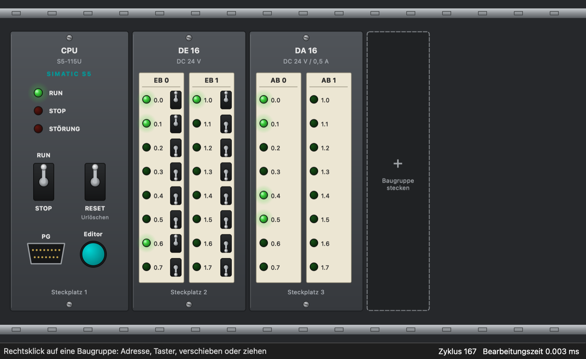

# S5Sim – Programmbeschreibung

S5Sim ist ein Simulator für Steuerungsprogramme der **SIMATIC S5** von Siemens. Programme werden in
**AWL** (Anweisungsliste, STEP 5) geschrieben, übersetzt und auf einer simulierten CPU zyklisch
bearbeitet. Ein- und Ausgänge werden über nachgebildete Baugruppen bedient, wie in einem echten
Baugruppenträger. Zusätzlich übersetzt S5Sim Programme in den **MC5-Maschinencode** der S5 und zurück.



## Zweck

- STEP-5-Programme ohne Hardware schreiben, testen und vorführen
- AWL lernen und auffrischen: Statusanzeige je Zeile, Einzelschritt, Variablentabelle
- MC5-Maschinencode erzeugen und lesen, als Grundlage für eine spätere Übertragung zur echten CPU

## Überblick

| Bereich | Inhalt |
|---|---|
| Baugruppenträger | tauschbare CPU-Baugruppe (S5-90U/95U, 100U, 115U, 135U/155U) mit RUN/STOP-Schalter, Urlöschen, Status-LEDs und PG-Taster; steckbare Digitalein- und -ausgaben |
| Editor (PG) | AWL-Editor mit Syntaxhervorhebung, Status Baustein, Einzelschritt, Variablen, Meldungen, Maschinencode |
| CPU | Zyklische Bearbeitung von OB 1, Neuanlauf mit OB 21, Prozessabbild, VKE, AKKU 1/2, Zeiten, Zähler, Datenbausteine, Bausteinaufrufe, FB-Parameter |
| MC5 | Assembler AWL → MC5 und Disassembler MC5 → AWL für S5-90U/95U, 100U, 115U, 135U/155U |

## Aufbau

S5Sim ist in C++20 geschrieben. Die Oberfläche verwendet Qt 6, der Kern ist frei von Qt und lässt
sich eigenständig testen.

```
sps/
├── core/           Kern ohne Qt
│   ├── program.*   Datenmodell: Bausteine, Anweisungen, Operanden, FB-Parameter
│   ├── parser.*    Übersetzer AWL-Text → Programm, mit Fehlermeldungen je Zeile
│   ├── cpu.*       simulierte CPU: Zyklus, Logik, Zeiten, Zähler, DBs, Aufrufe
│   └── mc5.*       MC5-Assembler und -Disassembler, Speicherabbild
├── gui/            Oberfläche (Qt 6 Widgets)
│   ├── rackwindow.*    Hauptfenster: Baugruppenträger
│   ├── rackmodules.*   gezeichnete Baugruppen (CPU, DE, DA)
│   ├── plccontroller.* Zyklustakt und Betriebsarten, gemeinsam für Träger und Editor
│   ├── mainwindow.*    Editorfenster
│   ├── codeeditor.*    Editor mit Zeilennummern und Statusspalte
│   ├── awlhighlighter.*, watchpanel.*, mc5view.*, format.*
│   └── main.cpp
├── examples/       Beispielprogramme (auch im Menü des Editors)
├── tests/          Tests für Parser, CPU und MC5
└── docs/           diese Beschreibung und das Handbuch
```

### Datenfluss

1. Der **Parser** zerlegt den AWL-Text in Bausteine (OB, PB, FB, SB, DB) und prüft Syntax,
   Operandenbereiche, Sprungmarken, FB-Parameter und die STEP-5-Regeln (z.B. ergänzende Operationen
   nur im FB). Fehler werden mit Zeilennummer gemeldet.
2. Die **CPU** lädt das übersetzte Programm. Der `PlcController` ruft sie alle 10 ms für einen Zyklus
   auf und lässt die Zeiten in Echtzeit laufen.
3. Die **Baugruppen** schreiben in das Peripherie-Eingangsabbild und lesen das Peripherie-Ausgangsabbild.
   Der **Editor** zeigt den Status je Zeile, die Variablen und den Maschinencode.
4. Der **MC5-Assembler** erzeugt aus demselben Programm Maschinencode für die gewählte CPU-Familie; der
   Disassembler macht daraus wieder übersetzbaren AWL-Text.

### Verhalten der simulierten CPU

- **Zyklus:** Prozessabbild der Eingänge lesen → OB 1 bearbeiten → Prozessabbild der Ausgänge ausgeben.
  Ausgänge ändern sich deshalb – wie bei der echten CPU – erst am Zyklusende.
- **Neuanlauf** (Schalter auf RUN): Ausgänge, Merker, Zeiten und Zähler werden gelöscht, dann wird
  einmal OB 21 bearbeitet (falls vorhanden) und anschließend zyklisch OB 1.
- **STOP:** Bearbeitung angehalten, Ausgänge auf 0 (Befehlsausgabesperre).
- **Urlöschen:** löscht zusätzlich die Datenbausteine (Rückkehr zu den Anfangswerten aus dem Programm).
- **Laufzeitfehler** führen in den STOP und werden mit Zeile gemeldet: fehlender Baustein oder DB,
  Datenwort außerhalb des DB, ungültiger BCD-Wert für Zeit oder Zähler, mehr als 16 Bausteinebenen,
  mehr als 7 Klammerebenen, mehr als 1 000 000 Anweisungen in einem Zyklus (Endlosschleife).

### Mengengerüst

| Operand | Bereich |
|---|---|
| Eingänge / Ausgänge | E/A 0.0 … 127.7, EB/AB 0 … 127, EW/AW 0 … 126 |
| Merker | M 0.0 … 255.7, MB 0 … 255, MW 0 … 254 |
| Zeiten / Zähler | T 0 … 127, Z 0 … 127 |
| Datenbausteine | DB 0 … 255, Datenwörter DW 0 … 2047 (im MC5-Code adressierbar: DW 0 … 255) |
| Bausteine | OB, PB, FB, SB, DB jeweils Nummer 0 … 255 |

## Umfang des Befehlsvorrats

- **Verknüpfungen:** `U UN O ON`, `O` (UND vor ODER), `U( O( )`, `= S R`, im FB zusätzlich `P PN SU RU`
- **Laden/Transferieren:** `L LC T` mit EB, EW, AB, AW, MB, MW, DW, DL, DR, T, Z und den Konstanten
  KF, KH, KM, KY, KB, KT, KZ, KC
- **Zeiten und Zähler:** `SI SV SE SS SA R`, `ZV ZR S R`
- **Arithmetik und Vergleich:** `+F -F XF :F`, `!=F ><F >F >=F <F <=F`
- **Im FB:** `UW OW XOW KEW KZW SLW SRW I D TAK`, Sprünge `SPA SPB SPZ SPN SPP SPM SPO =Marke`, `B =Parameter`
- **Bausteine:** `SPA/SPB PB/FB/SB`, `BE BEA BEB`, `A DB`, `STP`, `NOP`, `BLD`
- **FB-Parameter:** `NAME`, `BEZ` mit den Arten E/A (BI, BY, W), D (KM KH KY KC KF KT KZ), B, T, Z;
  Formaloperanden `=NAME`, Versorgung beim Aufruf, Durchreichen an weitere FBs

## MC5-Maschinencode

Die Codierung folgt den Siemens-Operationslisten („Auflistung des Maschinencodes“) der S5-115U,
S5-90U/95U, S5-100U und S5-135U/155U sowie den Handbuchangaben zu Bausteinkopf und FB-Aufbau:

- **Bausteinkopf:** 5 Wörter – Kennung `7070`, Bausteintyp und -nummer, zwei Wörter PG-Kennung bzw.
  Bibliotheksnummer (von S5Sim mit 0 belegt), Länge in Wörtern einschließlich Kopf
- **FB:** Sprung `SPA=` über Name (8 Zeichen) und Parameterliste (je 3 Wörter: Art, Format, 4 Zeichen Name)
- **FB-Aufruf:** `SPA/SPB FB n`, Sprung über die Parameterliste, je Parameter ein Wort
- **Netzwerke:** `***` wird als `BLD 255` abgelegt

Je nach gesteckter CPU wird – beim Übersetzen und im Maschinencode – geprüft, ob eine Operation dort
existiert (`XF`, `:F`, Datenbits `U D n.m` und `P/SU/RU` mit E/A/M nur bei S5-135U/155U). Die Tests prüfen jeden Einzelcode gegen die Siemens-Tabelle
sowie den Rundlauf AWL → MC5 → AWL → MC5 auf Bitgleichheit.

**Bewusst nicht erzeugt**, weil in den Quellen nicht belegt: die Kennung der Parameterart Z im FB-Kopf
und das Durchreichen von Formaloperanden im Maschinencode. **Abgeleitet** (nicht direkt dokumentiert)
ist die Codierung von Zeit- und Zählerparametern beim FB-Aufruf.

## Grenzen

- Keine Übertragung zur echten CPU (AS511 über die PG-Schnittstelle) und kein Lesen von STEP-5-Dateien
  (`*.S5D`) – beides ist vorbereitet, aber noch nicht umgesetzt
- Nicht unterstützt: `FR`, `LW =`, indirekte Adressierung (`B MW`, `B DW`), Peripheriezugriffe
  (`L PB/PW`), S-Merker, Gleitpunktarithmetik, Alarm- und Weckalarm-OBs, KOP/FUP-Darstellung, Haltepunkte
- Analogbaugruppen gibt es noch nicht

## Bauen und Tests

```sh
brew install qt cmake
cmake -S . -B build
cmake --build build -j8
./build/s5core_tests     # Parser und CPU
./build/s5mc5_tests      # MC5-Assembler/-Disassembler
open build/S5Sim.app
```

Die Bedienung ist im [Handbuch](handbuch.md) beschrieben.
