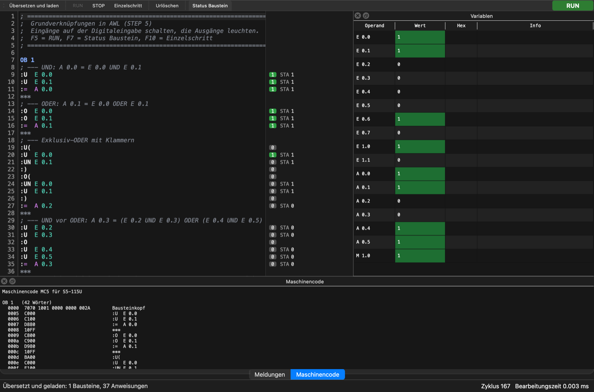

# S5Sim – Handbuch

Dieses Handbuch beschreibt die Bedienung von S5Sim und gibt eine Kurzreferenz der unterstützten
AWL-Operationen. Einen technischen Überblick gibt die [Programmbeschreibung](beschreibung.md).

**Inhalt**

1. [Installation und Start](#1-installation-und-start)
2. [Erste Schritte](#2-erste-schritte)
3. [Der Baugruppenträger](#3-der-baugruppenträger)
4. [Der Editor (PG)](#4-der-editor-pg)
5. [AWL-Kurzreferenz](#5-awl-kurzreferenz)
6. [Funktionsbausteine mit Parametern](#6-funktionsbausteine-mit-parametern)
7. [Maschinencode (MC5)](#7-maschinencode-mc5)
8. [Beispielprogramme](#8-beispielprogramme)
9. [Fehlermeldungen und Tipps](#9-fehlermeldungen-und-tipps)
10. [Tastenkürzel](#10-tastenkürzel)

---

## 1. Installation und Start

S5Sim wurde unter macOS entwickelt und getestet; unter Linux sollte es mit Qt 6 ebenso laufen.
Benötigt werden ein C++20-Compiler, CMake und Qt 6.

```sh
brew install qt cmake          # macOS, einmalig
cmake -S . -B build
cmake --build build -j8
open build/S5Sim.app           # Linux: ./build/S5Sim
```

Beim ersten Start erscheint der Baugruppenträger mit einer CPU, einer Digitaleingabe DE 16 (EB 0 und
EB 1) und einer Digitalausgabe DA 16 (AB 0 und AB 1). Im Editor ist das Beispiel
„Grundverknüpfungen“ geladen. Später öffnet S5Sim die zuletzt verwendete Datei.

---

## 2. Erste Schritte

1. **Editor öffnen:** Auf der CPU-Baugruppe den runden Taster **Editor** neben der PG-Buchse drücken
   (oder ⌘E). Der Editor zeigt das Beispielprogramm.
2. **CPU starten:** Im Baugruppenträger den Kippschalter der CPU auf **RUN** legen. Das Programm wird
   automatisch übersetzt, die grüne LED **RUN** leuchtet.
3. **Eingänge schalten:** Auf der Digitaleingabe die Kippschalter bei **0.0** und **0.1** umlegen.
   Die grünen LEDs der Eingänge leuchten, auf der Digitalausgabe leuchten die roten LEDs **0.0** (UND) und **0.1** (ODER).
4. **Zuschauen:** Im Editor zeigt die Statusspalte neben jeder Anweisung das Verknüpfungsergebnis (VKE)
   und den Signalzustand des Operanden.
5. **Ändern:** Programm im Editor ändern, mit ⌘B übersetzen – die CPU arbeitet ab dem nächsten Zyklus
   mit dem neuen Programm weiter.



---

## 3. Der Baugruppenträger

Der Baugruppenträger ist das Hauptfenster. Auf Steckplatz 1 sitzt die CPU, rechts daneben die E/A-
Baugruppen und ein freier Steckplatz zum Stecken weiterer Baugruppen. Wird das Fenster geschlossen,
endet S5Sim (bei ungesicherten Programmänderungen folgt eine Rückfrage).

### 3.1 CPU-Baugruppe

| Element | Bedeutung |
|---|---|
| LED **RUN** (grün) | leuchtet im Betrieb, blinkt im Einzelschritt (HALT) |
| LED **STOP** (rot) | leuchtet, wenn die CPU im STOP ist |
| LED **STÖRUNG** (rot) | blinkt, wenn die CPU durch einen Fehler in den STOP gegangen ist |
| Kippschalter **RUN/STOP** | nach oben: Neuanlauf und zyklischer Betrieb; nach unten: STOP |
| Schalter **RESET – Urlöschen** | federt zurück; löscht Merker, Zeiten, Zähler und setzt die Datenbausteine auf ihre Anfangswerte. Nur im STOP möglich |
| **PG**-Buchse und Taster **Editor** | öffnet den Editor (Programmiergerät) |

Unter der CPU-Bezeichnung steht die gewählte S5-Familie (Einstellung im Editor unter
*CPU → Zielsystem*).

Beim Umlegen auf RUN übersetzt S5Sim ein geändertes Programm automatisch. Enthält es Fehler, bleibt die
CPU im STOP und die Statuszeile weist darauf hin; die Fehler stehen im Editor unter *Meldungen*.

### 3.2 E/A-Baugruppen

Es gibt Digitaleingaben (**DE**) und Digitalausgaben (**DA**) mit 8, 16 oder 32 Bit, also 1, 2 oder
4 Byte. Jedes Byte ist eine senkrechte Spalte mit der Byteadresse oben (z.B. **EB 0**) und den Bits
.0 bis .7 darunter. Jedes Bit hat eine Status-LED – grün bei Eingaben, rot bei Ausgaben.

- **Digitaleingabe:** Jeder Eingang ist entweder ein **Schalter** oder ein **Taster** – einzeln
  einstellbar, auch gemischt auf einer Karte:
  - **Schalter** (Kippschalter): Ein Klick legt ihn um, Hebel oben = 1. Er bleibt in seiner Stellung.
  - **Taster** (runder Drucktaster mit grauer Kappe): liefert nur 1, solange die Maustaste gedrückt ist –
    gut für Flanken, Zähleingänge und Anforderungstaster.

  Der Untertitel der Karte zeigt „Schalter“, „Taster“ oder „Schalter/Taster“; wird die Maus über einem
  Eingang gehalten, erscheint z.B. „E 0.3 – Taster“. Neue Karten haben nur Schalter.
- **Digitalausgabe:** Die LEDs zeigen die Ausgänge, wie sie die CPU am Zyklusende ausgibt.
  Im STOP sind alle Ausgänge aus.

**Baugruppe stecken:** Auf den freien Steckplatz **+** klicken oder das Menü *Baugruppe* verwenden.
Die neue Baugruppe erhält die nächste freie Adresse hinter den vorhandenen Baugruppen gleicher Art.

**Rechtsklick auf eine Baugruppe:**

| Eintrag | Wirkung |
|---|---|
| Anfangsadresse ändern … | erstes Byte der Baugruppe (EB bzw. AB 0 … 127) |
| E n.m als Schalter / E n.m als Taster | nur Digitaleingabe: stellt den Eingang unter dem Mauszeiger um |
| Alle Eingänge als Schalter / als Taster | nur Digitaleingabe: stellt die ganze Karte um |
| Nach links / Nach rechts | Steckplatz tauschen |
| Baugruppe ziehen | Baugruppe entfernen; die Eingänge einer gezogenen Eingabe gehen auf 0 |

Wird ein eingeschalteter Schalter zum Taster, geht der Eingang auf 0.

Zwei Baugruppen dürfen dieselbe Adresse haben – sie zeigen dann dieselben Bits.

Bestückung und Fensterposition werden beim Beenden gespeichert.

### 3.3 Statuszeile

Die Statuszeile zeigt Hinweise und Fehlermeldungen (z.B. „STOP – Zeile 12: …“). Zyklusnummer und
Bearbeitungszeit stehen in der Statuszeile des Editors.

---

## 4. Der Editor (PG)

Der Editor ist das Programmiergerät. Er wird über den PG-Taster der CPU oder ⌘E geöffnet. Schließen
blendet ihn nur aus; Programm und CPU laufen weiter. ⌘1 holt den Baugruppenträger nach vorn.

### 4.1 Aufbau

| Bereich | Inhalt |
|---|---|
| Werkzeugleiste | Übersetzen und laden, RUN, STOP, Einzelschritt, Urlöschen, Status Baustein; rechts die Betriebsart (RUN/STOP/HALT) |
| Editor | AWL-Quelltext mit Zeilennummern, Syntaxhervorhebung und Statusspalte |
| Variablen | alle im Programm verwendeten Operanden mit aktuellem Wert |
| Meldungen | Übersetzungsfehler, Laufzeitfehler, Betriebsartwechsel; Doppelklick springt zur Zeile |
| Maschinencode | MC5-Code des Programms (siehe Kapitel 7) |

Die Bereiche lassen sich über *Ansicht* ein- und ausblenden und frei anordnen.

### 4.2 Übersetzen und laden

*CPU → Übersetzen und laden* (⌘B) übersetzt den Quelltext. Fehler erscheinen unter *Meldungen* und
werden im Text rot hinterlegt. Ein fehlerfreies Programm wird sofort in die CPU geladen – auch im
Betrieb; die CPU setzt dann am nächsten Zyklusanfang mit dem neuen Programm fort. Beim Laden erhalten
die Datenbausteine wieder ihre Anfangswerte aus dem Quelltext.

Ein geändertes, noch nicht übersetztes Programm wird beim nächsten Start (RUN oder Einzelschritt)
automatisch übersetzt.

### 4.3 Status Baustein

Die Statusspalte rechts neben dem Text (ein/aus mit F7) zeigt für jede im letzten Zyklus bearbeitete
Zeile:

- **VKE** als Kästchen: grün „1“ oder grau „0“
- **STA**: den Signalzustand des abgefragten Operanden
- **AKKU1** bei Lade-, Transfer- und Rechenoperationen, als Festpunktzahl (KF) oder – mit
  *Ansicht → AKKU als Hex* – hexadezimal (KH)

Zeilen ohne Anzeige wurden im letzten Zyklus nicht bearbeitet (z.B. übersprungen). Wird ein Baustein
mehrfach aufgerufen, zeigt die Spalte die Werte des letzten Aufrufs.

### 4.4 Einzelschritt

**Einzelschritt** (F10) führt genau eine Anweisung aus. Die nächste Anweisung ist gelb hinterlegt, die
CPU steht in **HALT** (die RUN-LED blinkt).

- Aus dem STOP startet F10 einen Neuanlauf und hält vor der ersten Anweisung.
- Im Betrieb hält F10 am Ende des laufenden Zyklus an.
- RUN (F5) setzt den zyklischen Betrieb fort, STOP beendet ihn.

Zeiten laufen auch im Einzelschritt in Echtzeit weiter. Ausgänge ändern sich erst, wenn ein Zyklus
vollständig durchlaufen ist.

### 4.5 Variablen

Die Tabelle enthält automatisch alle Eingänge, Ausgänge, Merker, Zeiten und Zähler, die im Programm
vorkommen (auch die Aktualoperanden von FB-Aufrufen), sowie die ersten 64 Datenwörter jedes
Datenbausteins.

| Operand | Wert | Hex / Info |
|---|---|---|
| Bit (E, A, M) | 0 oder 1, grün hinterlegt bei 1 | – |
| Byte, Wort, Datenwort | Festpunktzahl | hexadezimal und als Bitmuster |
| Zeit | Restzeit als KT (z.B. `KT 045.1`) | Q (Signalzustand), „läuft“ |
| Zähler | Zählwert als KZ | Q (1 bei Zählwert ≠ 0) |

### 4.6 Dateien

AWL-Programme sind Textdateien (UTF-8, Endung `.awl`). Das Menü *Datei* bietet Neu, Öffnen, Speichern,
Speichern unter, MC5 exportieren/importieren und die Beispielprogramme.

---

## 5. AWL-Kurzreferenz

### 5.1 Programmaufbau

Ein Programm besteht aus Bausteinen. Jeder Baustein beginnt mit einer Kopfzeile und endet mit `BE`:

```
OB 1                  ; zyklisch bearbeitet
:SPA PB 1
:BE

PB 1
:U   E 0.0
:=   A 0.0
:BE
```

| Baustein | Aufgabe |
|---|---|
| `OB 1` | Organisationsbaustein, wird zyklisch bearbeitet (Pflicht) |
| `OB 21` | wird beim Neuanlauf einmal bearbeitet (optional) |
| `PB n` | Programmbaustein |
| `FB n` | Funktionsbaustein, auch mit Parametern (Kapitel 6) |
| `SB n` | Schrittbaustein |
| `DB n` | Datenbaustein |

Schreibweise:

- Ein Doppelpunkt am Zeilenanfang ist erlaubt (`:U E 0.0`), wie in STEP-5-Listings.
- **Sprungmarken** stehen vor dem Doppelpunkt: `M001:L MW 10` (nur im FB verwendbar).
- **Kommentare** beginnen mit `;` oder `//`.
- `***` trennt Netzwerke (Segmente).
- Groß-/Kleinschreibung spielt keine Rolle.

### 5.2 Operanden und Konstanten

| Operand | Beispiel | Bedeutung |
|---|---|---|
| `E` `A` `M` | `E 1.0`, `A 4.7`, `M 10.3` | Eingangs-, Ausgangs-, Merkerbit |
| `D` | `D 3.15` | Bit 0 … 15 des Datenworts 3 |
| `EB` `AB` `MB` | `EB 0` | Byte |
| `EW` `AW` `MW` | `MW 20` | Wort (2 Byte, das erste ist das höherwertige) |
| `DW` `DL` `DR` | `DW 5`, `DL 5`, `DR 5` | Datenwort, linkes bzw. rechtes Byte |
| `T` `Z` | `T 3`, `Z 1` | Zeit, Zähler |

| Konstante | Beispiel | Bedeutung |
|---|---|---|
| `KF` | `KF +100`, `KF -5` | Festpunktzahl −32768 … +32767 |
| `KH` | `KH 00FF` | Hexadezimal |
| `KM` | `KM 0000111100001111` | Bitmuster |
| `KY` | `KY 10,20` | zwei Bytes |
| `KB` | `KB 12` | ein Byte 0 … 255 |
| `KT` | `KT 050.1` | Zeitwert 0 … 999 mit Zeitbasis .0 = 10 ms, .1 = 100 ms, .2 = 1 s, .3 = 10 s |
| `KZ` | `KZ 010` | Zählwert 0 … 999 |
| `KC` | `KC AB` | zwei Zeichen |

### 5.3 Verknüpfungen

| Operation | Bedeutung |
|---|---|
| `U` / `UN` | UND / UND NICHT |
| `O` / `ON` | ODER / ODER NICHT |
| `O` (ohne Operand) | ODER-Verknüpfung von UND-Gruppen („UND vor ODER“) |
| `U(` `O(` `)` | Klammern, bis zu 7 Ebenen |
| `=` | Zuweisen des VKE |
| `S` / `R` | Setzen / Rücksetzen bei VKE 1 |

Die erste Abfrage nach `=`, `S`, `R`, einer Zeit- oder Zähleroperation oder einem bedingten Sprung ist
eine **Erstabfrage**: Sie beginnt eine neue Verknüpfung. Mehrere Zuweisungen hintereinander verwenden
dasselbe VKE.

```
; UND vor ODER:  A 0.3 = (E 0.2 UND E 0.3) ODER (E 0.4 UND E 0.5)
:U  E 0.2
:U  E 0.3
:O
:U  E 0.4
:U  E 0.5
:=  A 0.3

; Exklusiv-ODER mit Klammern
:U(
:U  E 0.0
:UN E 0.1
:)
:O(
:UN E 0.0
:U  E 0.1
:)
:=  A 0.2
```

Zeiten und Zähler lassen sich wie Bits abfragen: `U T 1` ist 1, wenn die Zeit ihren Ausgang gesetzt
hat; `U Z 1` ist 1, wenn der Zählwert ungleich 0 ist.

### 5.4 Laden und Transferieren

| Operation | Bedeutung |
|---|---|
| `L` | AKKU 1 → AKKU 2, dann Operand in AKKU 1 laden |
| `LC T n` / `LC Z n` | Zeit- bzw. Zählwert BCD-codiert laden |
| `T` | AKKU 1 in Byte oder Wort transferieren |

Bytes werden rechtsbündig geladen, beim Transfer in ein Byte zählt das rechte Byte von AKKU 1.
`L T n` und `L Z n` laden den Zeit- bzw. Zählwert dual.

### 5.5 Zeiten

Vor dem Starten wird der Zeitwert geladen, gestartet wird durch einen Flankenwechsel des VKE.

```
:U  E 0.3
:L  KT 020.1      ; 2 s
:SE T 5           ; Einschaltverzögerung
:U  T 5
:=  A 0.3
```

| Operation | Zeitart | Ausgang Q |
|---|---|---|
| `SI` | Impuls | 1 ab Start, solange VKE 1 und die Zeit läuft |
| `SV` | verlängerter Impuls | 1 ab Start für die volle Zeit, unabhängig vom VKE |
| `SE` | Einschaltverzögerung | 1 nach Ablauf, solange VKE 1 |
| `SS` | speichernde Einschaltverzögerung | 1 nach Ablauf, bis `R T` |
| `SA` | Ausschaltverzögerung | 1 bei VKE 1 und noch die Zeit lang nach dem Abfall |
| `R T n` | Rücksetzen | Zeit anhalten, Q = 0 |

### 5.6 Zähler

| Operation | Bedeutung |
|---|---|
| `ZV Z n` | vorwärts zählen bei steigender Flanke (bis 999) |
| `ZR Z n` | rückwärts zählen bei steigender Flanke (bis 0) |
| `S Z n` | bei steigender Flanke auf den Wert in AKKU 1 setzen (`L KZ 005` vorher) |
| `R Z n` | bei VKE 1 auf 0 setzen |

### 5.7 Arithmetik und Vergleich

Rechnen mit 16-Bit-Festpunktzahlen: AKKU 2 und AKKU 1 werden verknüpft, das Ergebnis steht in AKKU 1.

| Operation | Bedeutung |
|---|---|
| `+F` `-F` | Addition, Subtraktion |
| `XF` `:F` | Multiplikation, Division (Rest in AKKU 2); im Maschinencode nur bei S5-135U/155U |
| `!=F` `><F` `>F` `>=F` `<F` `<=F` | Vergleich AKKU 2 mit AKKU 1, Ergebnis im VKE |

```
:L   MW 20
:L   KF +10
:>=F              ; VKE = (MW 20 >= 10)
:=   A 0.0
```

### 5.8 Bausteine und Datenbausteine

| Operation | Bedeutung |
|---|---|
| `SPA PB n` / `SPB PB n` | Baustein unbedingt / bei VKE 1 aufrufen (auch FB, SB) |
| `BE` | Bausteinende |
| `BEA` / `BEB` | Bausteinende absolut / bei VKE 1 |
| `A DB n` | Datenbaustein aufschlagen; gilt im Baustein und in aufgerufenen Bausteinen |
| `STP` | CPU geht am Zyklusende in den STOP |
| `NOP 0`, `NOP 1`, `BLD n` | keine Wirkung |

Ein Datenbaustein enthält eine Konstante je Zeile, optional mit Adresse:

```
DB 10
0: KF +100
1: KF +23
2: KH 00FF
```

### 5.9 Ergänzende Operationen (nur im FB)

Wie bei STEP 5 sind diese Operationen nur in Funktionsbausteinen erlaubt:

| Operation | Bedeutung |
|---|---|
| `SPA =M001`, `SPB =M001` | Sprung absolut / bei VKE 1 |
| `SPZ` `SPN` `SPP` `SPM` `SPO` | Sprung bei Ergebnis = 0, ≠ 0, > 0, < 0, Überlauf |
| `UW` `OW` `XOW` | Wortverknüpfung AKKU 1 mit AKKU 2 |
| `KEW` `KZW` | Einer- / Zweierkomplement |
| `SLW n` `SRW n` | Schieben links / rechts um 0 … 15 |
| `I n` `D n` | rechtes Byte von AKKU 1 erhöhen / verringern |
| `TAK` | AKKU 1 und AKKU 2 tauschen |
| `P` `PN` `SU` `RU` | Bit prüfen auf 1 / auf 0, Bit unbedingt setzen / rücksetzen |

```
FB 1
NAME :SUMME
; Summe 1 + 2 + … + 10 in MW 30
:L  KF +0
:T  MW 30
:L  KF +10
:T  MW 32
M001:L  MW 30
:L  MW 32
:+F
:T  MW 30
:L  MW 32
:L  KF +1
:-F
:T  MW 32
:SPN =M001        ; weiter, solange das Ergebnis ≠ 0 ist
:BE
```

---

## 6. Funktionsbausteine mit Parametern

### 6.1 Deklaration

Am Anfang des FB stehen der Name und die Parameter (Bausteinparameter, „BEZ“):

```
FB 10
NAME :MOTOR
BEZ  :EIN   E/A/D/B/T/Z: E  BI/BY/W/K: BI
BEZ  :AUS   E/A/D/B/T/Z: E  BI/BY/W/K: BI
BEZ  :ZEIT  E/A/D/B/T/Z: D  KM/KH/KY/KC/KF/KT/KZ/KG: KT
BEZ  :MOT   E/A/D/B/T/Z: A  BI/BY/W/K: BI
:U  =EIN
:O  =MOT
:UN =AUS
:=  =MOT
:BE
```

Die Kurzform `BEZ :EIN E BI` ist ebenfalls erlaubt.

- Der Bausteinname hat höchstens 8, ein Parametername höchstens 4 Zeichen und beginnt mit einem Buchstaben.
- `NAME` und `BEZ` müssen vor der ersten Anweisung stehen.
- Parameternamen dürfen nicht wie eine Sprungmarke heißen.

| Art | Typ | Aktualoperand beim Aufruf |
|---|---|---|
| `E`, `A` | `BI` | Bit: `E 0.0`, `A 4.1`, `M 10.0`, `D 1.0` |
| `E`, `A` | `BY` | Byte: `EB`, `AB`, `MB`, `DL`, `DR` |
| `E`, `A` | `W` | Wort: `EW`, `AW`, `MW`, `DW` |
| `D` | `KM KH KY KC KF KT KZ` | Konstante genau dieses Formats, z.B. `KT 050.1` |
| `B` | – | Baustein: `DB n`, `PB n`, `FB n`, `SB n` |
| `T` | – | Zeit `T n` |
| `Z` | – | Zähler `Z n` |

### 6.2 Formaloperanden

Im FB werden die Parameter als Formaloperanden `=NAME` verwendet, z.B. `U =EIN`, `L =ZEIT`, `SE =TIM`,
`T =ERG`. Bei der Bearbeitung wird der Formaloperand durch den Aktualoperanden des Aufrufs ersetzt.

Ein Bausteinparameter (Art B) wird mit `B =NAME` bearbeitet: Ist der Aktualoperand ein Datenbaustein,
wird er aufgeschlagen, sonst wird der Baustein aufgerufen. Alternativ sind `A =NAME` (nur für einen DB)
und `SPA =NAME` (nur für PB, FB oder SB) möglich.

### 6.3 Aufruf

Nach `SPA FB n` bzw. `SPB FB n` folgen der optionale Name und die Aktualoperanden, je Zeile
`Parameter :Operand`, in beliebiger Reihenfolge:

```
:SPA FB 10
NAME :MOTOR
EIN  :E 0.0
AUS  :E 0.1
ZEIT :KT 050.1
MOT  :A 4.0
```

Beim Übersetzen wird geprüft, dass jeder Parameter genau einmal und mit passendem Typ versorgt ist und
dass der Name zum FB passt.

Ein FB kann seine eigenen Formaloperanden an einen weiteren FB **durchreichen**:

```
:SPA FB 2
X    :=EIN
```

Art und Typ müssen dabei übereinstimmen (E und A sind untereinander austauschbar). Im Simulator
funktioniert das; in Maschinencode lässt es sich nicht übersetzen (siehe Kapitel 7).

---

## 7. Maschinencode (MC5)

### 7.1 Zielsystem

Unter *CPU → Zielsystem (MC5)* wird die S5-Familie gewählt: **S5-90U/95U**, **S5-100U**, **S5-115U**
oder **S5-135U/155U**. Sie bestimmt, welche Operationen im Maschinencode erlaubt sind:

| Operation | 90U/95U, 100U, 115U | 135U/155U |
|---|---|---|
| `XF`, `:F` | nicht vorhanden | ✓ |
| Verknüpfungen mit Datenbits `U D n.m` usw. | nicht vorhanden | ✓ |
| `P PN SU RU` mit `D n.m` | ✓ (im FB) | ✓ (im FB) |
| `P PN SU RU` mit `E`, `A`, `M` | nicht vorhanden | ✓ (im FB) |

Der Simulator selbst führt alle Operationen aus – die Prüfung betrifft nur den Maschinencode.

### 7.2 Ansicht „Maschinencode“

Der Reiter *Maschinencode* im Editor zeigt nach jedem Übersetzen den MC5-Code je Baustein:

```
OB 1   (42 Wörter)
  0000  7070 1001 0000 0000 002A   Bausteinkopf
  0005  C000                       :U  E 0.0
  0006  C100                       :U  E 0.1
  0007  D880                       :=  A 0.0
  0008  10FF                       ***
```

Links steht die Wortadresse im Baustein, dann die Maschinenwörter (hexadezimal) und die AWL-Zeile.
Lässt sich das Programm für das gewählte Zielsystem nicht übersetzen, stehen die Gründe mit Zeilennummer
am Anfang der Ansicht.

### 7.3 Exportieren und Importieren

- *Datei → MC5 exportieren …* speichert alle Bausteine als **Speicherabbild** (`*.mc5`): die Bausteine
  mit ihrem 5-Wort-Kopf (Kennung `7070`) hintereinander, Wörter mit dem höherwertigen Byte zuerst.
- *Datei → MC5 importieren …* liest ein solches Abbild (Füllbytes zwischen den Bausteinen werden
  übersprungen) und übersetzt es zurück in AWL. Sprungmarken heißen danach `M001`, `M002` …,
  Datenbausteine werden hexadezimal (KH) dargestellt, Kommentare gehen verloren.
  Unbekannte oder nicht unterstützte Codes erscheinen als Kommentar und unter *Meldungen*.

### 7.4 Einschränkungen

- PG-Kennung und Bibliotheksnummer im Bausteinkopf werden mit 0 belegt.
- Datenwörter sind im Maschinencode nur bis DW 255 adressierbar.
- Nicht übersetzbar, weil die Codierung nicht dokumentiert ist: Parameter der Art **Z** und das
  Durchreichen von Formaloperanden. S5Sim meldet dann einen Fehler, statt Code zu raten.
- STEP-5-Dateien (`*.S5D`) werden noch nicht gelesen; eine Übertragung zur echten CPU gibt es noch nicht.

---

## 8. Beispielprogramme

Die Beispiele stehen im Editor unter *Datei → Beispiele*:

| Beispiel | Inhalt | Bedienung |
|---|---|---|
| Grundverknüpfungen | UND, ODER, XOR mit Klammern, UND vor ODER, Speicher, Selbsthaltung | E 0.0 … E 1.1 schalten |
| Zeiten | Blinker, alle fünf Zeitarten, Treppenhauslicht | E 0.1 … E 0.6; A 0.0 blinkt sofort |
| Zähler und Vergleicher | vorwärts/rückwärts zählen, Vorgabe setzen, Vergleich ≥ 10 | E 0.0 als Taster |
| Fußgängerampel | Schrittkette mit OB 21, PB und Zeiten | E 0.0 als Taster; A 0.x Autos, A 1.x Fußgänger |
| Bausteine, DB und Schleife | bedingter Aufruf, Rechnen im DB, Schleife im FB | E 0.0/E 0.1 Motor, E 0.7 ruft PB 2 |
| Funktionsbausteine mit Parametern | ein Motor-FB zweimal aufgerufen, Takt-FB, Zähler mit DB-Parameter | E 0.0 … E 0.2, E 1.0 … E 1.2 |

Die Beispiele verwenden die Grundbestückung (Eingänge EB 0/EB 1, Ausgänge AB 0/AB 1).

---

## 9. Fehlermeldungen und Tipps

| Meldung | Ursache und Abhilfe |
|---|---|
| *Organisationsbaustein OB 1 fehlt* | Jedes Programm braucht einen `OB 1`. |
| *Anweisung außerhalb eines Bausteins* | Vor der ersten Anweisung fehlt die Kopfzeile, z.B. `OB 1`. |
| *… ist eine ergänzende Operation und nur im FB erlaubt* | Sprünge auf Marken, Wortverknüpfungen usw. in einen FB verlegen. |
| *Sprungmarke … ist nicht definiert* | Marke fehlt oder ist falsch geschrieben (`M001:` vor der Anweisung). |
| *Kein Datenbaustein aufgeschlagen* | Vor `L DW …` fehlt `A DB n`. |
| *DW … liegt außerhalb von DB …* | Der DB hat weniger Datenwörter als adressiert. |
| *Ungültiger Zeitwert in AKKU 1* | Vor `SE T …` usw. wurde kein `KT`-Wert geladen. |
| *Zykluszeit überschritten (Endlosschleife?)* | Ein Sprung führt immer wieder zurück; Abbruchbedingung prüfen. |
| *FB n: Parameter nicht versorgt: …* | Beim Aufruf fehlen Parameterzeilen. |
| *… gibt es nur bei S5-135U/155U* | Nur für den Maschinencode relevant: anderes Zielsystem wählen oder Operation ersetzen. |

**Tipps**

- Eingänge, die nur kurz anliegen sollen (Zählimpulse, Anforderungen), als **Taster** schalten.
- Ausgänge ändern sich erst am **Zyklusende** – im Einzelschritt also erst nach `BE` des OB 1.
- Für ein VKE von 1 ohne Eingang: `UN M 10.0` / `ON M 10.0` (ergibt immer 1).
- Bei unerwartetem Verhalten den Einzelschritt (F10) verwenden und Statusspalte und Variablen beobachten.

---

## 10. Tastenkürzel

| Taste | Fenster | Funktion |
|---|---|---|
| ⌘E | Baugruppenträger | Editor öffnen |
| ⌘1 | Editor | Baugruppenträger nach vorn |
| ⌘B | Editor | Übersetzen und laden |
| F5 | Editor | RUN |
| ⇧F5 | Editor | STOP |
| F10 | Editor | Einzelschritt |
| F7 | Editor | Status Baustein ein/aus |
| ⌘N / ⌘O / ⌘S | Editor | Neu / Öffnen / Speichern |
| ⌘Q | beide | Beenden |

Unter Linux steht Strg statt ⌘.

Einstellungen (Fensterpositionen, Bestückung, Zielsystem, zuletzt geöffnete Datei) speichert S5Sim
unter macOS in `~/Library/Preferences/com.s5sim.S5Sim.plist`, unter Linux in
`~/.config/S5Sim/S5Sim.conf`.
